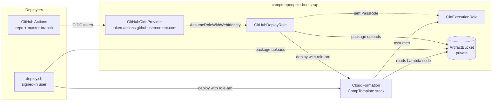
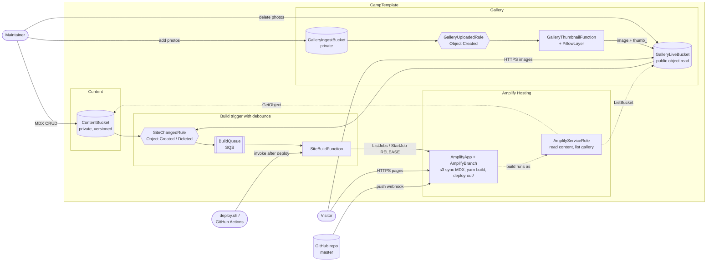

# Infrastructure

Two CloudFormation stacks. Deploy steps are in the [root README](../README.md#infrastructure).

## Bootstrap stack (`bootstrap.yaml`)

Deployed once per account by an admin. It holds the roles and bucket that app deploys use.

## App stack (`app.yaml`)

Each Lambda has its own role (`SiteBuildRole`, `GalleryThumbnailRole`) and its own log group, which keeps logs for 90 days.

Maintainers use `MaintainerRole`, not the deploy roles. It can:

| Bucket | Can do |
| --- | --- |
| `ContentBucket` | List, and read, write and delete `*.mdx` files. |
| `GalleryIngestBucket` | List and write files. |
| `GalleryLiveBucket` | List and delete files. |
